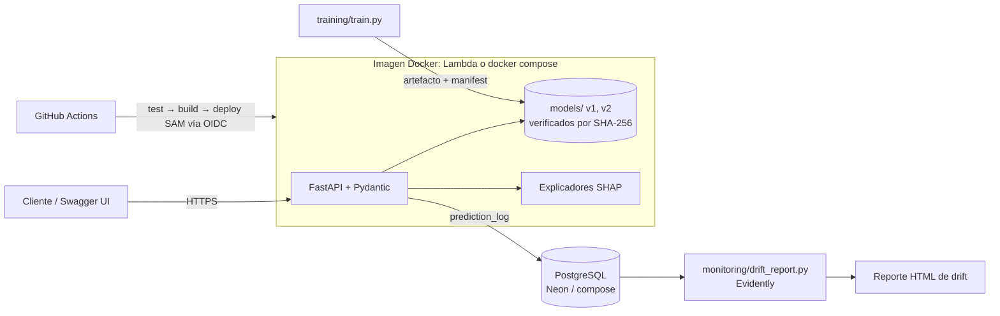

# PredictAPI

[](https://github.com/IgnisCreator/PredictAPI/actions/workflows/ci.yml)

API de predicción de riesgo crediticio que explica cada respuesta. Sirve modelos versionados de scikit-learn entrenados con el dataset German Credit y devuelve explicaciones SHAP por predicción. Además registra cada inferencia en PostgreSQL junto con el artefacto exacto que la produjo, y detecta drift de datos con Evidently.

[English version](README.md) · [Model card (EN)](docs/model_card.md) · [Decisiones técnicas (EN)](docs/decisions.md) · [Evidencia de validación (EN)](docs/validation.md)

> Proyecto de portafolio. No sirve para decisiones de crédito reales: ver las limitaciones en la model card.

## Qué hace

| Endpoint | Para qué |
|---|---|
| `POST /predict?model_version=` | Probabilidad de no pago y decisión según el umbral de costo de esa versión |
| `POST /explain?model_version=` | Lo mismo, más la contribución SHAP de cada uno de los 20 datos, de mayor a menor |
| `GET /models` | Versiones publicadas, métricas, umbrales y hashes de los artefactos |
| `GET /health`, `GET /ready` | Si el servicio está vivo; si está listo (modelo cargado, estado de la base de datos) |

La documentación interactiva (Swagger UI) está en `/docs`. Cada entrada se valida contra el schema guardado con el modelo. Las categorías desconocidas, los montos negativos y los campos de más se rechazan con 422.

Ejemplo real: una persona de 22 años pide 5.951 DM a 48 meses. v1 responde **bad** con 55,9% de probabilidad. Los factores que más pesan son el plazo de 48 meses (+0,755), el saldo de su cuenta corriente (+0,375) y el monto (+0,336).

## Arquitectura



## Resultados

Todas las cifras salen de [`docs/validation.md`](docs/validation.md) y se midieron en el test intacto de 200 filas.

| Modelo | Umbral | ROC AUC | Costo medio por solicitante* |
|---|---|---|---|
| Baseline (rechazar a todos) | — | 0,500 | 0,70 |
| v1 regresión logística con 0,5 | 0,50 | 0,804 | 0,78 |
| **v1 regresión logística (default)** | **0,13** | **0,804** | **0,57** |
| v2 gradient boosting | 0,14 | 0,792 | 0,56 |

\* Matriz de costo de German Credit: aprobar a un mal pagador cuesta 5, rechazar a uno bueno cuesta 1.

Con el umbral habitual de 0,5, el modelo es **peor que rechazar a todos**. Elegir el umbral con la matriz de costo, usando solo los datos de entrenamiento, es lo que lo vuelve útil. v2 no supera a v1 en validación cruzada, por eso v1 sigue como default.

**Latencia.** Medida desde el cliente, contra la imagen de producción en docker compose, con 500 peticiones de a 10 a la vez y registro activo, en un notebook con Windows 11:

| Endpoint | p50 | p95 |
|---|---|---|
| `/predict` | 135 ms | 173 ms |
| `/explain` | 221 ms | 297 ms |

La inferencia del modelo, medida en el servidor, toma 8 ms (p50).

**Drift.** Al reenviar el test con `credit_amount` ×3 y `duration` ×2, Evidently marca exactamente esas dos columnas (K-S p < 0,0001).

## Ejecutar en local

Requisitos: Docker con Compose y [uv](https://docs.astral.sh/uv/) para las pruebas y los scripts.

```bash
cp .env.example .env                 # y define una contraseña local
docker compose up -d --build --wait  # API en :8000, PostgreSQL en :5433
# Swagger UI: http://localhost:8000/docs
```

```bash
uv sync
uv run pytest -q                                   # 17 pasan; +3 de BD con DATABASE_URL
uv run python monitoring/send_traffic.py --shift   # tráfico desplazado al registro
uv run --group monitoring python monitoring/drift_report.py
uv run python monitoring/load_test.py              # latencia; sube RATE_LIMIT_PER_MINUTE antes
```

## Desplegar en AWS

La misma imagen corre en AWS Lambda gracias al [Lambda Web Adapter](https://github.com/awslabs/aws-lambda-web-adapter), detrás de una Function URL pública. La base de datos es un PostgreSQL gratuito de [Neon](https://neon.tech). GitHub Actions despliega con credenciales temporales (OIDC), así que no hay claves de AWS guardadas en ningún lado.

Configuración, una sola vez:

1. En AWS CloudFormation, crea un stack con `infra/github-oidc.yaml`. Copia el valor de salida `DeployRoleArn`.
2. En GitHub → Settings → Secrets and variables → Actions:
   - Variables: `AWS_DEPLOY_ROLE_ARN` y `AWS_REGION`.
   - Secret: `DATABASE_URL` (la cadena de conexión de Neon).
3. Fusiona a `main`. El job `deploy` ejecuta `sam deploy` y prueba `/ready`. La URL aparece en el resumen del job.

## Limitaciones

- **Datos.** 1.000 filas de Alemania en los años 70, con atributos sensibles y sin auditoría de fairness.
- **Imagen.** La imagen pesa 795 MB.
- **Límite de peticiones.** Se cuenta por proceso.
- **Pendiente.** La URL pública depende de la configuración de AWS, y falta el video demo.

## Uso de herramientas de IA

El proyecto se construyó con Claude Code como programador en pareja. Yo definí el alcance y aprobé cada hito. Claude Code escribió la mayor parte del código, ejecutó los experimentos y registró la evidencia, y yo revisé los resultados en cada pull request.

Varias decisiones salieron de revisar ejecuciones reales:

- El umbral por costo.
- El cortacircuito de la base de datos.
- Mantener v1 como modelo por defecto.
