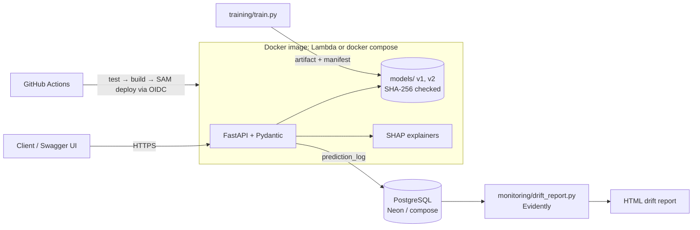

# PredictAPI

[](https://github.com/IgnisCreator/PredictAPI/actions/workflows/ci.yml)

Credit-risk prediction API that explains every answer. It serves versioned scikit-learn models trained on the German Credit dataset, returns per-prediction SHAP explanations, logs every inference to PostgreSQL with the exact artifact that produced it, and reports data drift with Evidently.

[Versión en español](README.es.md) · [Model card](docs/model_card.md) · [Technical decisions](docs/decisions.md) · [Validation evidence](docs/validation.md)

> Portfolio project. Not for real lending decisions: see the model card's limitations.

## What it does

```bash
curl -X POST "http://localhost:8000/explain" -H "content-type: application/json" -d @applicant.json
```

Response (abridged; real output for a 22-year-old asking 5,951 DM over 48 months):

```json
{
  "prediction": "bad",
  "probability_bad": 0.559,
  "threshold": 0.13,
  "model_version": "v1",
  "logged": true,
  "contributions": [
    {"feature": "duration", "value": 48, "shap": 0.755},
    {"feature": "checking_status", "value": "0<=X<200", "shap": 0.375},
    {"feature": "credit_amount", "value": 5951, "shap": 0.336}
  ]
}
```

| Endpoint | Purpose |
|---|---|
| `POST /predict?model_version=` | Probability of default, decision at the version's cost-based threshold |
| `POST /explain?model_version=` | Same, plus SHAP contribution of each of the 20 inputs (log-odds), largest first |
| `GET /models` | Published versions, metrics, thresholds, artifact hashes |
| `GET /health`, `GET /ready` | Liveness; readiness (model loaded, database status) |

Interactive docs (Swagger UI) at `/docs`. Every input is validated against the schema stored with the model: unknown categories, negative amounts and extra fields return 422.

## Architecture



- **Training** (`training/train.py`): stratified 80/20 split, every transform inside the sklearn `Pipeline`, a dummy baseline, and model selection by 5-fold CV on train only. Each artifact is registered in `models/manifest.json` with its hash, feature schema, metrics and library versions.
- **Serving** (`app/main.py`): loads an artifact only if its SHA-256 matches the manifest. `joblib` is pickle and runs code on load.
- **Logging** (`app/db.py`, `migrations/`): every inference is stored with its artifact hash. If the database is down, the API keeps answering with `"logged": false` (ADR-004).

## Results

All numbers come from [`docs/validation.md`](docs/validation.md). They are measured on the untouched 200-row test set.

| Model | Threshold | ROC AUC | Avg. cost per applicant* |
|---|---|---|---|
| Baseline (reject everyone) | — | 0.500 | 0.70 |
| v1 logistic regression at 0.5 | 0.50 | 0.804 | 0.78 |
| **v1 logistic regression (default)** | **0.13** | **0.804** | **0.57** |
| v2 gradient boosting | 0.14 | 0.792 | 0.56 |

\* German Credit's cost matrix: approving a bad applicant costs 5, rejecting a good one costs 1.

At the usual 0.5 threshold the model is **worse than rejecting everyone**. Choosing the threshold from the cost matrix (on training data only) is what makes it useful. v2 does not beat v1 in cross-validation, so v1 stays the default.

**Latency.** Measured client side against the production image in docker compose, with 500 requests at concurrency 10 and logging on, on a Windows 11 laptop:

| Endpoint | p50 | p95 |
|---|---|---|
| `/predict` | 135 ms | 173 ms |
| `/explain` | 221 ms | 297 ms |

Server-side inference alone is 8 ms at p50. The full breakdown is in the validation log.

**Drift.** Replaying the test split with `credit_amount` ×3 and `duration` ×2, Evidently flags exactly those two columns (K-S p < 0.0001).

## Run it locally

Requirements: Docker with Compose, and [uv](https://docs.astral.sh/uv/) for tests and scripts.

```bash
cp .env.example .env                 # then set a local password
docker compose up -d --build --wait  # API on :8000, PostgreSQL on :5433
# Swagger UI: http://localhost:8000/docs
```

```bash
uv sync
uv run pytest -q                                   # 17 pass; +3 DB tests with DATABASE_URL set
uv run python training/train.py v1                 # retrain (v1 is byte-identical)
uv run python monitoring/send_traffic.py --shift   # feed the log with shifted traffic
uv run --group monitoring python monitoring/drift_report.py
uv run python monitoring/load_test.py              # latency; raise RATE_LIMIT_PER_MINUTE first
```

## Deploy to AWS

The same image runs on AWS Lambda through the [Lambda Web Adapter](https://github.com/awslabs/aws-lambda-web-adapter), behind a public Function URL. The database is a free [Neon](https://neon.tech) PostgreSQL. GitHub Actions deploys with short-lived OIDC credentials; no AWS keys are stored anywhere.

One-time setup:

1. In AWS CloudFormation, create a stack from `infra/github-oidc.yaml`. It creates the role `predictapi-github-deploy`, which only `main` of this repo can assume and which can only touch `predictapi*` resources. Copy its `DeployRoleArn` output.
2. In GitHub → Settings → Secrets and variables → Actions:
   - Variables: `AWS_DEPLOY_ROLE_ARN` (step 1) and `AWS_REGION`.
   - Secret: `DATABASE_URL` (the Neon connection string).
3. Merge to `main`. The `deploy` job runs `sam deploy` with `infra/template.yaml`, then smoke-tests `/ready`. The URL appears in the job summary.

## Technical decisions

The main choices are summarised here; reasons and trade-offs are in [`docs/decisions.md`](docs/decisions.md).

| Decision | Reason |
|---|---|
| uv | One lockfile for local, CI and Docker |
| SHA-256-checked artifacts | Pickles execute code on load |
| Cost-based threshold | The dataset defines asymmetric costs |
| Fail-open logging with a circuit breaker | Availability over audit for a demo; fail-closed for real credit |
| Plain SQL migrations instead of an ORM | One table does not justify one |
| In-memory rate limit | Simple; documented ceiling with several replicas |
| Lambda + Neon | About $0/month for a demo |

## Limitations

- **Data.** 1,000 rows from 1970s Germany, with sensitive attributes (`personal_status`, `foreign_worker`, `age`) and no fairness audit. See the [model card](docs/model_card.md).
- **Image size.** The image is 795 MB; scipy, pandas, scikit-learn and numpy make up most of it.
- **Rate limiting.** The rate limit is per process: on Lambda each concurrent instance counts separately.
- **Deployment and video.** The live demo URL depends on the AWS setup above. The demo video is pending.

## How AI tools were used

This project was built with Claude Code as a pair programmer. I defined the scope and approved each milestone; Claude Code wrote most of the code, ran the experiments and recorded the evidence, and I reviewed the results in each pull request.

Several decisions came from inspecting real runs rather than from the first draft:

- The cost-based threshold, after seeing that 0.5 lost to the baseline.
- The circuit breaker, after measuring 8 s requests with the database down.
- Keeping v1 as the default, after cross-validation showed v2 did not improve it.

Every number in this README is traceable to a command in [`docs/validation.md`](docs/validation.md).
